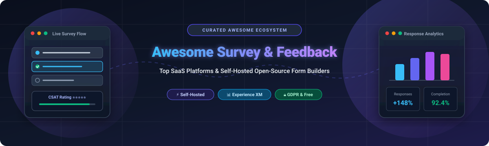
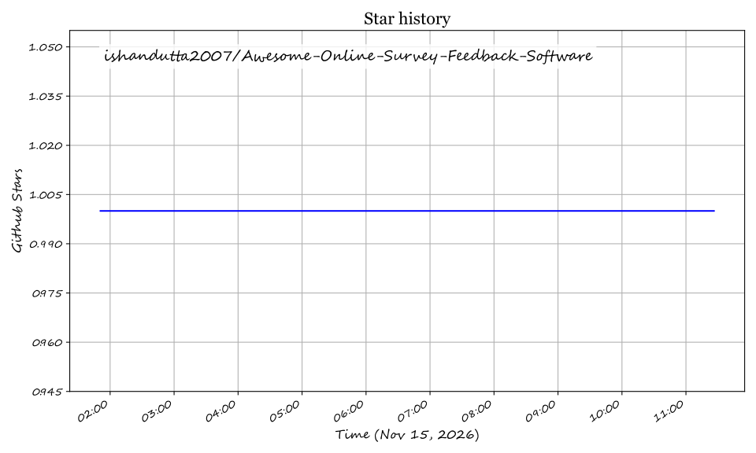

# Awesome Online Survey & Feedback Software 📝📊

  

  
  
  
  
  
  

---

> 🚀 **A curated, comprehensive directory of top Online Survey, Experience Management (XM), and Customer Feedback Software platforms** — featuring battle-tested SaaS leaders alongside cutting-edge self-hosted open-source alternatives for creating interactive forms, collecting responses, and unlocking actionable product analytics.
>
> 🌟 *Star this repository to stay updated on the best survey and feedback tools!* 🌟

---

## 📋 Table of Contents

- [🌐 Sector Overview & Market Dynamics](#-sector-overview--market-dynamics)
- [🟦 SaaS / Hosted Platforms](#-saas--hosted-platforms)
- [🟩 Open-Source Software](#-open-source-software)
- [📊 Comparison at a Glance](#-comparison-at-a-glance)
- [💖 Support & Sponsorship](#-support--sponsorship)
- [📈 Star History](#-star-history)
- [🤝 Contributing](#-contributing)
- [📄 License](#-license)

---

## 🌐 Sector Overview & Market Dynamics

The global online survey and feedback software market is currently estimated between **$5.1 billion and $6.4 billion**, projected to grow at a CAGR of **13% to 18%** to exceed **$15B–$25B+** over the next decade. The sector is **moderately to highly fragmented** rather than winner-take-all: low barriers to entry for simple form building and wide variations in customer needs sustain numerous niche players, though enterprise experience management (XM) exhibits higher concentration around heavyweights like Qualtrics, SurveyMonkey, and Medallia.

---

## 🟦 SaaS / Hosted Platforms

Commercial, cloud-hosted Online Survey and Feedback Software platforms. These are not open-source but are included as reference points for feature comparison.

| Platform | Company Size (Valuation / Revenue) | Starting Price | Free Tier Limit | Description |
| :--- | :--- | :--- | :--- | :--- |
| **Google Forms** 📝 | ~$2.1T+ market cap / ~$350B+ ann. rev (Alphabet) | $7/user/month (via Google Workspace Business Starter; standalone tool is $0) | Free forever (Unlimited surveys and responses; limited only by 10M cell Google Sheet limit and 15 GB shared Google Drive storage) | Free, simple form builder within Google Workspace integrated with Google Sheets for response collection. |
| **Qualtrics CoreXM** 🏢 | $13B acquisition valuation / ~$1.4B+ ann. rev | $420/month ($5,040/year billed annually for self-serve Strategic Research; CoreXM enterprise starts ~$25,000–$50,000/year) | Free forever (500 total lifetime responses, up to 3 active surveys, max 30 questions per survey, 1 user) | Enterprise experience management platform providing sophisticated statistical analysis and multi-channel feedback collection. |
| **SurveyMonkey** 🐵 | ~$4.1B peak valuation (STG acquisition) / ~$480M+ ann. rev | $39/month (billed annually at $468/yr) or $149/month (billed monthly) | Free forever (10 questions per survey, 40 viewable responses per survey, unlimited surveys, no data export) | Industry-standard survey platform offering extensive template libraries, logic branching, and analytics. |
| **Typeform** 💬 | $935M valuation (Series C) / ~$90M+ ARR | $28/month (billed annually) or $39/month (billed monthly) | Free forever (10 responses/month across all forms, unlimited forms) | Conversational, design-focused form builder popularized for one-question-at-a-time form experience. |
| **Alchemer** ⚙️ | ~$400M–$500M valuation (KKR-backed) / ~$40M+ ARR | $55/user/month (billed monthly) or $26.25/user/month ($315/year billed annually) | 7-day free trial (Full evaluation access to features and response collection; no credit card required) | Enterprise survey platform with advanced logic, custom workflows, and deep reporting. |
| **Jotform** 📑 | Bootstrapped ($0 VC raised) / ~$145M+ ann. rev | $34/month (billed annually) or $39/month (billed monthly) | Free forever (5 active forms, 100 submissions/month, 500 total stored submissions, 100 MB storage, 10 payment submissions/month) | Form builder with extensive integrations, drag-and-drop builder, and payment support. |

---

## 🟩 Open-Source Software

Self-hosted, privacy-first, community-driven Online Survey and Feedback Software tools. Repositories below are ordered by GitHub Stars_Counts (descending).

### Formbricks  🧱
**Stack:** TypeScript / Next.js / PostgreSQL / Redis | **License:** AGPLv3 (core) / Enterprise (separate)  
Formbricks is the leading open-source **experience management (XM) suite**, explicitly positioned as an open-source alternative to Qualtrics, Typeform, SurveyMonkey, and Google Forms. It goes beyond simple surveys with:
- **In-app micro-surveys** with precise user targeting based on user attributes, events, and segments
- **Website surveys** embeddable via a single JavaScript snippet or tag manager
- **Link surveys** with custom branding, responsive layouts, and shareable URLs
- **20+ question types** including NPS, CES, CSAT, matrix, ranking, rating, and file upload
- **Skip logic and conditional branching** with multi-language survey capabilities
- **Built-in analytics** with interactive graphs, filterable metrics, and CSV/JSON export
- **Native integrations** with Slack, Notion, Google Sheets, Airtable, Zapier, Webhooks, and n8n

*Deployment:* Self-hosting is available via Docker with PostgreSQL (pgvector-enabled) and Redis. Hosted cloud tier available.  
**Best for:** Product and growth teams wanting in-app and website surveys with event-based targeting and a modern Next.js UI.

---

### Typebot  🤖
**Stack:** TypeScript / Next.js / React / Prisma / PostgreSQL | **License:** AGPL-3.0  
Typebot is a powerful conversational form and chatbot builder that allows you to collect data, feedback, and leads conversive chat experiences. It is an open-source alternative to Typeform and Landbot:
- **Visual drag-and-drop builder** with modular blocks for logic, questions, conditional forks, and API calls
- **Conversational feedback collection** yielding high completion rates compared to static forms
- **Dynamic embeds** anywhere as an inline chat widget, standard bubble, popup, or standalone web page
- **Rich input blocks** for text, email, rating, file uploads, date pickers, and payment processing (Stripe)
- **Deep ecosystem integrations** with OpenAI, Google Sheets, Make.com, Zapier, Slack, and Webhooks

*Deployment:* Self-hostable using Docker and Docker Compose.  
**Best for:** Teams looking to replace traditional forms with conversational chatbot surveys and interactive lead capture flows.

---

### HeyForm  ⚡
**Stack:** TypeScript / React / Vite / Node.js / MongoDB | **License:** AGPL-3.0  
HeyForm is a modern, open-source online form builder that enables you to create interactive conversational surveys, quizzes, and polls with zero coding knowledge:
- **Interactive form blocks** supporting multiple-choice, picture selection, ratings, NPS, signatures, and file uploads
- **Smart branching logic** and URL redirection based on respondent answers
- **Customizable themes** with fine-grained control over colors, typography, and custom branding
- **Built-in response analytics** and automated export capabilities
- **Third-party integrations** for webhooks, email alerts, and data warehousing

*Deployment:* Easily self-hosted with Docker Compose.  
**Best for:** Marketers, educators, and creators who need sleek, customizable conversational surveys with a clean design.

---

### SurveyJS  🧩
**Stack:** JavaScript / TypeScript (React, Angular, Vue 3, jQuery) | **License:** MIT (Core libraries)  
SurveyJS is a free and open-source JSON-driven JavaScript form library and questionnaire framework designed for deep developer embedding:
- **Framework agnostic** with native UI components for React, Angular, Vue, and vanilla JavaScript
- **JSON-based schemas** allowing dynamic generation, storage, and manipulation of survey layouts in your own databases
- **Rich question collection** with 20+ built-in question types, matrices, dynamic panels, and custom widgets
- **Conditional logic engine** handling dynamic visibility, computed values, custom expressions, and validation rules
- **Accompanying GUI Survey Creator** (commercial) for visual drag-and-drop design

*Deployment:* Integrated directly into existing frontend applications via npm packages.  
**Best for:** Software engineers and development teams who need full control over survey rendering within their own web applications.

---

### OpnForm  📋
**Stack:** Laravel / Nuxt / PostgreSQL / Redis | **License:** AGPL-3.0  
OpnForm is a lightweight, open-source **Typeform alternative** built on Laravel and Nuxt. It focuses on beautiful, performant surveys, contact forms, and lead generation:
- **Drag-and-drop builder** with real-time preview and intuitive editing
- **Conditional logic** to show or hide fields based on previous answers
- **File uploads & signatures** directly stored in S3-compatible cloud storage
- **AI form creation** assistance using OpenAI APIs
- **Webhooks & notifications** with native Slack, Discord, and Google Sheets integrations

*Deployment:* Ready-to-go deployment with Docker or Railway.  
**Best for:** Developers and businesses wanting a quick, modern Typeform replacement on a Laravel and Nuxt architecture.

---

### LimeSurvey  🍋
**Stack:** PHP / MySQL / PostgreSQL / MariaDB | **License:** GPL v2.0  
LimeSurvey is the veteran powerhouse of open-source surveying, in active development for over two decades and trusted across universities, governments, and enterprise market research teams:
- **Unlimited surveys, questions, and responses** with 30+ sophisticated question types and 900+ community templates
- **Enterprise-grade logic**: multi-level condition builders, question branching, piping, and quota management
- **Multilingual surveys** with built-in translations supporting 80+ languages
- **Compliance & privacy**: fully GDPR-compliant, anonymized responses, and WCAG 2.0 accessibility
- **Extensible API**: RemoteControl API (XML-RPC / JSON-RPC), plugin engine, and LDAP/SAML single sign-on

*Deployment:* Standard LAMP/LEMP stack (PHP 8.2+ and relational database). Hosted cloud option available.  
**Best for:** Academic institutions, governments, and research teams needing complex statistical questionnaires and multi-language surveys.

---

### QuillForms  ✒️
**Stack:** React / TypeScript / WordPress | **License:** Open Source  
QuillForms is a modern conversational form and survey builder designed specifically for the WordPress ecosystem as an open-source Typeform alternative:
- **Conversational multi-step forms** that present questions one step at a time for maximum engagement
- **Native WordPress integration** via Gutenberg blocks, shortcodes, and elementor widgets
- **Conditional branching** and jump logic based on user responses
- **Built-in calculation engine** for quizzes, cost estimators, and order forms

*Deployment:* Installed directly as a WordPress plugin.  
**Best for:** WordPress publishers and agencies wanting Typeform-grade conversational forms without paying monthly SaaS subscriptions.

---

### FormsLab  🔬
**Stack:** TypeScript / Next.js / React / Prisma / MongoDB | **License:** MIT  
FormsLab is an emerging, modern open-source web application designed for fast, anonymous feedback, polls, and custom survey creation:
- **Minimalist clean interface** built on Next.js App Router and Tailwind CSS
- **Anonymous survey submission** allowing frictionless customer and workplace feedback
- **Real-time charts and metrics** for tracking response distributions
- **Permissive MIT license** providing complete freedom for personal and commercial adaptation

*Deployment:* Deployable to Vercel, Railway, or any Node.js container with MongoDB.  
**Best for:** Developers looking for a clean, MIT-licensed Next.js codebase to self-host lightweight feedback forms.

---

### OpenFlow  🌊
**Stack:** Node.js / React / SQLite | **License:** Open Source  
OpenFlow is a lightweight, self-hosted lead-generation form builder and multi-step survey maker tailored for startups, agencies, and small businesses:
- **Drag-and-drop form canvas** with responsive preview and customizable styling
- **Lightweight architecture** powered by an embedded SQLite database (no complex external DB needed)
- **White-label branding**, editable custom subdomains, and auto-resizing iframe embeds
- **Google Tag Manager & cookie consent** integration out-of-the-box

*Deployment:* Single Docker container deployment.  
**Best for:** Startups and SMEs seeking a simple, low-overhead self-hosted lead capture and survey tool.

---

## 📊 Comparison at a Glance

| Software | Model | GitHub_Stars | Stack | In-App Surveys | Logic Branching | Self-Hosted | Best For |
| :--- | :--- | :--- | :--- | :--- | :--- | :--- | :--- |
| **Google Forms** 📝 | SaaS | N/A | Cloud | ❌ | ⚠️ Basic | ❌ | Free simple surveys & spreadsheets |
| **Qualtrics CoreXM** 🏢 | SaaS | N/A | Cloud | ✅ | ✅ Advanced | ❌ | Enterprise experience management & research |
| **SurveyMonkey** 🐵 | SaaS | N/A | Cloud | ❌ | ✅ | ❌ | Industry-standard survey research |
| **Typeform** 💬 | SaaS | N/A | Cloud | ❌ | ✅ | ❌ | Conversational interactive forms |
| **Alchemer** ⚙️ | SaaS | N/A | Cloud | ❌ | ✅ Advanced | ❌ | Enterprise survey workflows |
| **Jotform** 📑 | SaaS | N/A | Cloud | ❌ | ✅ | ❌ | Payments, forms & business workflows |
| **Formbricks** 🧱 | Open-Source | ⭐ 13.2k+ | TypeScript / Next.js | ✅ In-app & Web | ✅ Advanced | ✅ | In-app user micro-surveys & XM |
| **Typebot** 🤖 | Open-Source | ⭐ 10.6k+ | TypeScript / Next.js | ✅ Chatbot & Web | ✅ Visual Flow | ✅ | Conversational chat surveys & lead gen |
| **HeyForm** ⚡ | Open-Source | ⭐ 9.0k+ | TypeScript / React | ❌ | ✅ | ✅ | Conversational forms & polls |
| **SurveyJS** 🧩 | Open-Source | ⭐ 4.9k+ | JS / React / Vue | ✅ Embeddable | ✅ Advanced | ✅ | Embedded JSON survey developer library |
| **OpnForm** 📋 | Open-Source | ⭐ 4.0k+ | Laravel / Nuxt | ❌ | ✅ | ✅ | Open-source Typeform alternative |
| **LimeSurvey** 🍋 | Open-Source | ⭐ 3.7k+ | PHP / Relational DB | ❌ | ✅ Advanced | ✅ | Heavy-duty academic & multilingual surveys |
| **QuillForms** ✒️ | Open-Source | ⭐ 600+ | React / WordPress | ❌ | ✅ | ✅ | WordPress native conversational forms |
| **FormsLab** 🔬 | Open-Source | ⭐ 500+ | TypeScript / Next.js | ❌ | ⚠️ Basic | ✅ | Lightweight MIT feedback forms |
| **OpenFlow** 🌊 | Open-Source | ⭐ <100 | Node.js / SQLite | ❌ | ⚠️ Basic | ✅ | Lightweight lead-gen forms |

---

## 💖 Support & Sponsorship

If you find this curated list helpful, please consider supporting its maintenance! Your support helps keep this repository continuously updated with the latest open-source releases, SaaS pricing shifts, and architectural breakdowns.

- ⭐ **Star this repository** to help others discover it!
- 🍴 **Fork the repo** to contribute your favorite tools or insights.
- 📢 **Share with colleagues** in product, engineering, and data teams.
- ☕ **Buy me a coffee & support future projects via GitHub Sponsors:**  
  

---

## 📈 Star History

---

## 🤝 Contributing

Contributions are warmly welcome! If you maintain or use an open-source or notable Online Survey / Feedback tool that should be listed here:

1. Fork this repository.
2. Add your tool under the appropriate section in alphabetical or star-ranked order.
3. Submit a pull request detailing the stack, license, and why it stands out.

Please ensure the project is actively maintained (commits or releases within the last 12 months) and adheres to open-source licensing standards.

---

## 📄 License

This repository and curated list are released under the [Creative Commons Zero v1.0 Universal](LICENSE) (CC0 1.0 - Public Domain).  
All product trademarks, logos, and repository brandings belong to their respective owners.

---

  ⭐ <b>If this list helped you discover a useful tool, please star the repo!</b> ⭐

## Star History

<a href="https://star-history.com/#ishandutta2007/Awesome-Online-Survey-Feedback-Software&Timeline" align="center">
  <picture>
    <source media="(prefers-color-scheme: dark)" srcset="assets/ishandutta2007_Awesome-Online-Survey-Feedback-Software_growth.svg">
    
  </picture>
</a>
